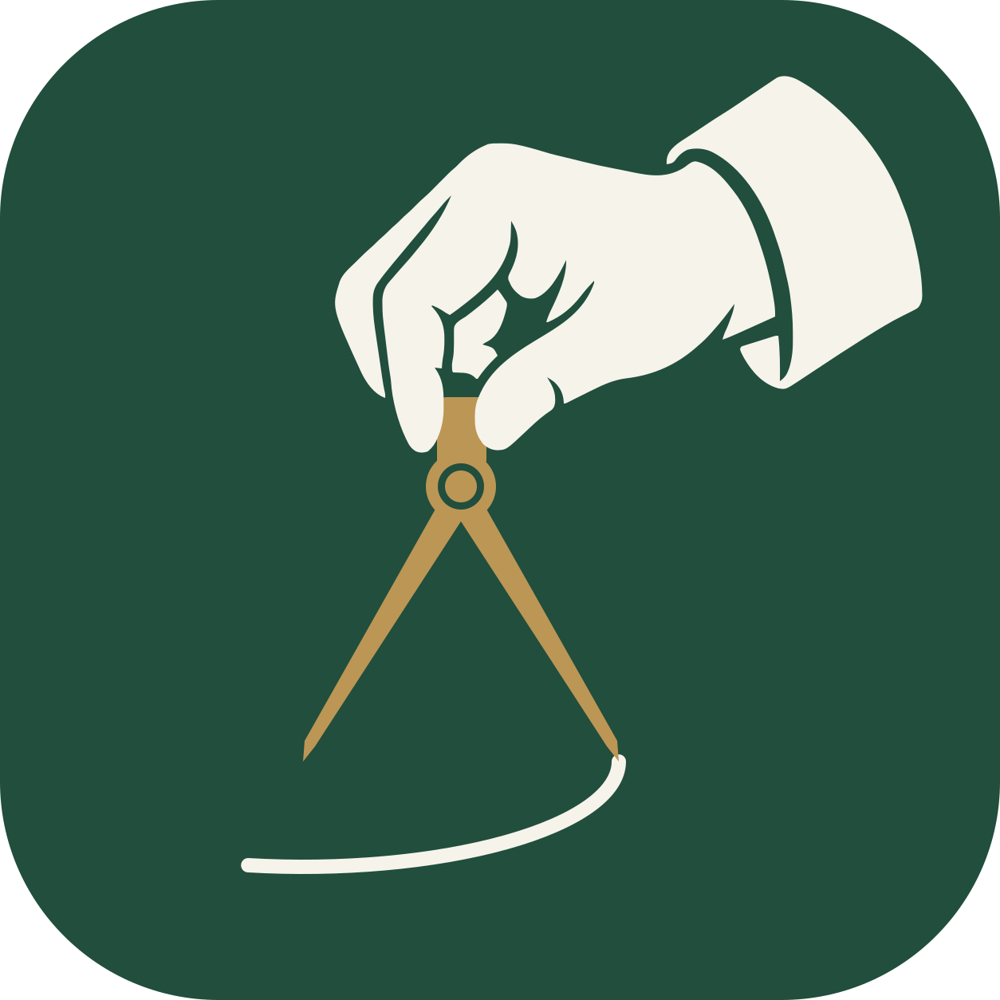

# Progettare branding

The approved identity pairs the family architect mascot with a hand holding a
drafting compass. The mark's ivory arc is projected onto the drawing plane.

  
  

## Canonical assets

Use these stable filenames in documentation, websites, and integrations:

| Asset | File | Format |
| --- | --- | --- |
| Architect mascot | [progettare-architect.png](progettare-architect.png) | 1254 × 1254 PNG, transparent background |
| Mark master | [progettare-mark.svg](progettare-mark.svg) | Scalable SVG, transparent corners |
| Mark raster | [progettare-mark.png](progettare-mark.png) | 1254 × 1254 PNG, transparent corners |

The canonical mascot is the v3 illustration with smooth fingertips matching
the sibling mascots. The canonical mark is
the approved v3 design with the projected ellipse. Versioned files preserve the
design iterations; new uses should reference the canonical files above.

## Palette

| Color | Hex | Use |
| --- | --- | --- |
| Forest | `#214E3D` | Mark background, clothing |
| Ivory | `#F6F3EB` | Hand, cuff, drawn arc, paper |
| Brass | `#BC9654` | Compass and small accents |
| Ink | `#243C32` | Mascot contour reference |

The mark uses only forest, ivory, and brass. The mascot also uses warm skin
tones and silver-white hair. Preserve the aspect ratio, clear margins, and
transparent background when placing either asset. Prefer the SVG for icons.

Generation prompts and the construction history are in
[image-prompts.md](image-prompts.md).
